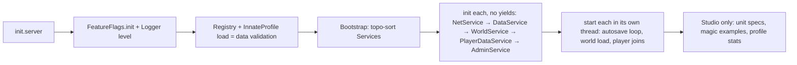

# Backend Architecture: Engineering Foundation (v1)

This document covers how the game is structured, how it saves, how the client and server talk, how it scales across servers, and how it resists exploits. The code it describes is under `src/`.

---

## 1. Explorer hierarchy

```
ReplicatedStorage
├─ Shared                          (src/shared): code both server and client need
│  ├─ Core/
│  │  ├─ Bootstrap                 loads services/controllers in dependency order
│  │  ├─ Signal, SignalBus, Topics publish/subscribe between services
│  │  ├─ Logger                    structured logs + in-memory buffer for the console
│  │  ├─ RateLimiter               token bucket
│  │  └─ FeatureFlags              runtime switches (replicated subset)
│  ├─ Net (+ Schema, Remotes)      the only client↔server channel
│  └─ Magic/                       spell grammar, MagicCore, Reservoir, Seed, shared data
├─ NetRemotes                      (created at runtime by Net; never edit by hand)
└─ FeatureFlags                    (created at runtime; attributes = replicated flags)

ServerScriptService
├─ Server                          (src/server/init.server.luau: server entry point)
│  ├─ Config/       Flags, Admins
│  ├─ Core/         ParallelPool
│  ├─ Persistence/  Retry, Codec, MockDataStore, Schemas
│  ├─ Services/     NetService, DataService, WorldService, PlayerDataService, SpellbookService, AdminService
│  ├─ Magic/        ProfileGenerator, InnateProfile, Data/ (ProfileTuning, AwakeningEvents)  [server-only secrets]
│  └─ Tests/        TestRunner, Core.spec, MagicExamples, ProfileStats
└─ <Name>Actors                    (created at runtime by ParallelPool)

ServerStorage
└─ Workers/         NpcScoringWorker (Actor worker template; never runs here)

StarterPlayer › StarterPlayerScripts
└─ Client                          (src/client/init.client.luau: client entry point)
   └─ Controllers/  DebugConsoleController
```

**Where future systems go:**
- **Server:** CastService, NpcService, QuestDirector and WorldGenService go in `Server/Services/`.
- **Client:** SpellbookController, HudController and VfxController go in `Client/Controllers/`.
- **Pure logic** that both sides need goes in `Shared/`.
- **Anything secret** (odds, seeds, hidden state) goes in `Server/`.

### Boot sequence



**How modules find each other:**
- `ctx.get("X")` works only for modules the caller listed in its `dependencies`, which keeps the dependency graph honest.
- Use **direct calls** for requests that need an answer (`PlayerDataService:get(player)`).
- Use **SignalBus topics** for notifications (`PlayerDataLoaded`, `NetViolation`), so the sender doesn't need to know who listens.

---

## 2. Net layer

Every remote is declared in `Shared/Net/Remotes.luau`, with its kind, direction, argument schemas, rate limit and size limit. **No other code creates or touches a RemoteEvent.**

| Check (in order) | Rejection reason |
|---|---|
| More arguments than declared | `TOO_MANY_ARGS` |
| Per-player token bucket for that remote | `RATE_LIMITED` |
| Estimated payload size, including a nesting-depth cap of 6 | `PAYLOAD_TOO_LARGE` |
| Each argument's schema (NaN and ±inf rejected, structs reject unknown keys, arrays reject holes, everything has a size bound) | `BAD_ARGUMENT` |

**What happens on a rejection:**
- The rejection is counted per player per minute.
- It's logged, at most once every 10 s per player/remote/reason.
- It's published as `NetViolation` on the bus.
- With `net_kick_on_abuse` on, a player who goes over `net_violation_threshold` is kicked with a neutral message. Never accuse the player in the kick text.

**Rules:**
- **No server→client RemoteFunctions.** A client can refuse to answer and hang a server thread forever.
- **Client-side rate limiting** mirrors the server's limit, so a spammy button can't get its own player kicked.
- **Unreliable remotes** are for cosmetic, high-frequency data only (aim direction). They're validated the same way.
- **Remote handlers run inside `xpcall`.** A handler error is logged and never escapes into the remote.

---

## 3. Persistence

### 3.1 What is saved where

| Scope | Store / key | Write pattern | Contents |
|---|---|---|---|
| **Player** | `PlayerData` / `player_<userId>` | Session-locked; autosave every 60 s, plus on leave and shutdown | Innate profile, progression, spellbook, discoveries (compressed), NPC relationships, inventory, settings, moderation notes, stats |
| **World** | `World` / `world_main` | Optimistic `UpdateAsync`, rare writes | Seed, epoch, global flags, chronicle (compressed, capped at 200) |
| **NPC** | `Npcs` / `npc_<npcId>` | Optimistic `UpdateAsync`, only for *named* NPCs whose state matters | Profile snapshot, alive, faction, offline-simulation day, mastery, notoriety, world-level memories (compressed) |
| *Not saved* | | | Generic NPCs (regenerated from the seed), live world state (fires, spells, positions), computed stats, Reservoir state |

**Each player's relationships with NPCs live in that player's own record, not the NPC's.** That's what lets an NPC "remember you" on every server, without any shared NPC state to keep in sync.

### 3.2 Session locking

```
load:  UpdateAsync(key): lock free, ours, or stale (> 180 s since refresh)?  → take it, return data
                         locked by a live server?                            → retry every 5 s, up to 6 times
save:  UpdateAsync(key): lock still ours? → write data, refresh lock.at      (else: LOCK_LOST → kick)
leave: same as save, but clears the lock
crash: the lock goes stale after 180 s → the next server takes it over; the dead server can never write again
```

**Shutdown:** `BindToClose` releases every session in parallel, within a 25 s budget.

**Newer data:** a record written by a newer schema version is refused (`NEWER_SCHEMA`). The player is asked to rejoin, which prevents an old server from downgrading new data during a rolling update.

**Every write is checked first:**
1. Schema `validate`.
2. A JSON-encode test.
3. A size check against 3.9 M characters.

A write that fails any of these is skipped and logged. Corrupt data is never written.

**Failures:** every DataStore call is wrapped in `Retry.call`, which uses exponential backoff with jitter and waits for request budget before each attempt.

### 3.3 Compression

Fields listed in a schema's `compress` are stored through `Codec`:

| Format | Meaning |
|---|---|
| `Z1:<base64(zstd(json))>` | Compressed with EncodingService |
| `J1:<json>` | Plain fallback, used when compression is unavailable or wouldn't help (JSON under 1 KB) |

Compression is self-tested at startup. If the test fails, saves silently fall back to J1, and decoding accepts both formats forever.

### 3.4 Save schemas and example payloads

All three records share the same envelope:

```jsonc
{ "schema": 2, "meta": { "createdAt": 1793500000, "updatedAt": 1793600000, "saves": 412,
                          "lock": { "jobId": "a1b2…", "placeId": 1234567, "at": 1793600000 } },
  "data": { /* per-scope shape below */ } }
```

**Player, v2 (current):**

```jsonc
{
  "profile": { "v": 1, "gen": 1, "worldSeed": 1337, "entityId": "player:12345", "kind": "Player",
               "giftTier": "Gifted", "potential": 0.52, "capacity": 1.13, "regen": 0.97,
               "domains": { "energy": 0.48, "water": 0.31, "earth": 0.031, "…": 0 },
               "manifest": ["energy", "water"], "temperaments": ["swift"], "growth": "late",
               "latents": [ { "id": "L1", "kind": "Domain", "target": "spirit", "strength": 0.41,
                              "triggers": ["Emotion", "Ritual"], "revealed": false } ],
               "…": "see InnateProfiles.md §7" },
  "progression": { "mastery": { "energy": 34.5, "thermal": 18.2 }, "knowledge": 1 },
  "spellbook": {
    "1|thermal|temperature|transfer|touch|3|reservoir|": {
      "recipe": { "v": 1, "branch": "thermal", "property": "temperature", "verb": "transfer",
                  "form": "touch", "modifiers": [], "power": 3, "costProfile": "reservoir" },
      "name": "Warm Hands", "favorite": true, "casts": 57, "addedAt": 1793550000 } },
  "discoveries": "Z1:KLUv/QBY…",            // compressed { recipes, locations, lore }
  "relationships": { "npc:millbrook:7": { "affinity": 22, "trust": 9,
                     "memories": [ { "t": 1793590000, "kind": "healed_me" } ] } },
  "inventory": { "currency": 340, "items": {} },
  "settings": { "reducedEffects": false, "consoleKey": "F2" },
  "moderation": { "warnings": 0, "notes": [] },
  "stats": { "joins": 18, "firstJoin": 1793500000, "lastJoin": 1793600000, "playtime": 40211, "casts": 912 }
}
```

**Player, v1 (legacy), and the v1 → v2 migration:**

```jsonc
// v1: spellbook was an array; no settings; no stats.casts
{ "progression": { "mastery": { "energy": 12 }, "knowledge": 0 },
  "spellbook": [ { "branch": "energy", "property": "temperature", "verb": "generate", "form": "touch", "power": 1 },
                 { "branch": "energy", "property": "luminosity", "verb": "sense", "form": "projectile", "power": 1 } ],
  "stats": { "joins": 3, "firstJoin": 1793000000, "lastJoin": 1793100000, "playtime": 900 } }
```

`Schemas.Player.migrations[1]` does the following:
1. It runs each recipe through `MagicCore.validateRecipe`.
2. Valid recipes are re-keyed by the canonical `recipeKey` into a map.
3. Invalid ones (the second recipe above is now illegal, because Sense can't be a Projectile) go to `spellbookQuarantine` for support. They're never silently dropped.

After the migration, *reconcile* fills `settings` and `stats.casts` from the v2 template. The result:

```jsonc
{ "spellbook": { "1|energy|temperature|generate|touch|1|reservoir|":
                 { "recipe": { … }, "name": "", "favorite": false, "casts": 0, "addedAt": 0 } },
  "spellbookQuarantine": [ { "branch": "energy", "property": "luminosity", "verb": "sense", "form": "projectile", "power": 1 } ],
  "settings": { "reducedEffects": false, "consoleKey": "F2" },
  "stats": { "joins": 3, "…": "…", "casts": 0 } }
```

**Rules for writing migrations:**
- Never edit a migration that has shipped.
- Write migrations as pure data transforms; they must not call out to services.
- Add a unit spec for every migration. `Core.spec` covers v1 → v2, both as a pure function and end to end through a mock session.

**World, v1:**

```jsonc
{ "seed": 1837364821, "createdAt": 1793400000, "epoch": 1793400000,
  "chronicle": "Z1:…",   // [{ "id": "jobId:3", "kind": "mythic_awakened", "t": 1793590000, "data": { "domain": "time" } }]
  "flags": { "firstMythicTime": 1793590000 } }
```

**NPC, v1 (named NPCs only):**

```jsonc
{ "npcId": "npc:millbrook:elder", "gen": 1, "profile": { "…": "InnateProfile snapshot" },
  "alive": true, "faction": "horologe", "lastSimDay": 212,
  "progression": { "mastery": { "chronokinesis": 41 } }, "notoriety": { "time": 18 },
  "memories": "J1:[{\"t\":1793580000,\"kind\":\"witnessed_starfall\"}]" }
```

### 3.5 Studio and right-to-erasure

**In Studio:** with `data_use_mock_in_studio` on (the default), all stores are in-memory. Play-tests never touch live data and don't need API access. Turn the flag off, and enable *Studio Access to API Services*, to test against real DataStores.

**Right-to-erasure:** when Roblox sends a deletion request for a user:
- Call `DataService:eraseUser(userId)`.
- Player keys are also written with `userIds` metadata, so they can be found for these requests.
- If you add stores keyed by user, add them to `eraseUser`.

---

## 4. Multi-server design

| Option | How it works | Pros | Cons |
|---|---|---|---|
| **A. One world, many servers** *(recommended)* | Every server runs the same seed: the same map, NPC identities and places. Live state is per-server. Player data is global | Simple; no cross-server conflicts; scales out by itself | Your server's fire doesn't exist on mine; there's no single "living" world |
| B. Persistent shards | A fixed number of named realms, each owned by one server at a time (locked world record), with matchmaking into shards | A truly persistent world per shard | Matchmaking, reserved servers, shard lock handling; an empty shard is dead; much more ops work |
| C. Globally merged world | All servers write shared world state through MemoryStore/DataStore | One living world | Conflict resolution everywhere; quotas; latency; very hard to get right |

**Decision (2026-11-02): Option A, plus a thin shared layer.** That layer is:
- **The world record** (seed, epoch, flags, chronicle) in the `World` DataStore, written rarely and idempotently.
- **MessagingService** for *announcements* of notable events: a mythic awakening, a starfall, a server-wide boss.
  - Messages are 1 KB at most, so they carry ids, not payloads.
  - Delivery is best-effort; nothing depends on it.
- **MemoryStoreService** (next phase) for **ephemeral shared feeds**:
  - A global *rumours* sorted map with a TTL. NPCs gossip about events from other servers.
  - Leaderboards.
  - Mythic notoriety heat.
  - All of it expires by design, so nothing breaks if it's lost.
- **NPCs stay consistent across servers without being synced.**
  - Their profiles are deterministic from the seed.
  - Their long-term progression is a deterministic function of `(seed, npcId, worldDay)`, simulated "offline".
  - Per-player relationships live in player data.
  - Only rare, world-level NPC facts (death of a named NPC, faction change) go into `Npcs` records.

**Quotas to respect:**
- DataStore request budgets, MessagingService publish and subscribe rates, and MemoryStore memory and request quotas all scale with player counts.
- `Retry` waits for DataStore budget before each request.
- The admin `perf` command shows the remaining budget.
- Check the current published limits before relying on exact numbers.

---

## 5. Parallel Luau

| System | Benefit | Why |
|---|---|---|
| NPC utility scoring (100–300 NPCs) | **High** | Pure math per NPC; batches of ~50 per job |
| Noise / terrain sampling for WorldGen chunks | **High** | Pure functions over a grid; write Terrain in serial afterwards |
| Wave / fluid / fire-spread steps | **High** | Grid simulations; the results are applied to Instances in serial |
| Batch profile generation (spawning a village) | Medium | Deterministic, pure; about 55 µs each |
| `listAvailableRecipes` for NPC spell planning | Medium | Pure; cache the result per NPC |
| Pathfinding, DataStores, VFX, anything touching Instances | **No** | Must run serially, or yields |

**Template:**
- `Server/Core/ParallelPool` (the pool) and `ServerStorage/Workers/NpcScoringWorker` (the worker).
- Workers run `BindToMessageParallel` and do pure math only. They call `task.synchronize()` just before firing their result.
- The pool waits for each Actor's `Ready` signal before sending jobs.

**Rules:**
- **Send batches, not single items.** Every message is deep-copied, so per-message overhead dominates small jobs.
- **Use about 4–8 Actors on the server.**
- **Never share mutable tables between Actors.** Use `SharedTable` only for read-mostly data.

---

## 6. Profiling and debugging

| Tool | Use |
|---|---|
| **Debug console** (F2, admins only) | `help`, `perf`, `watch` (a live 2 s dashboard of server and client stats), `cperf`, `flags`, `flag <name> <value>`, `log [n]`, `players`, `profile <player> [level\|truth]`, `save <player>` |
| `perf` | Heartbeat and physics step time, physics FPS, memory by tag, instance and moving-part counts, network in/out, DataStore budgets, active sessions, warning and error counts |
| Structured logs | `[LEVEL][Scope] event key=value`; the last 500 are kept in memory for `log`; the level can be changed live (`flag log_level Debug`) |
| Feature flags | Kill switches (`magic_casting_enabled`, `awakenings_enabled`), abuse kicking, autosave interval, compression, debug toggles. All changeable live |
| MicroProfiler (Ctrl+F6) | Wrap hot loops in `debug.profilebegin("NpcScoring")` / `debug.profileend()` |
| Developer Console (F9) | Server memory and script activity, and ScriptProfiler for hotspots |

**Live flags are per server.** A change made from the console lasts until that server shuts down. To change a flag globally (next phase), store overrides in a `Config` DataStore key, poll it every 60 s, and broadcast changes over MessagingService.

---

## 7. Testing

| Layer | How |
|---|---|
| **Unit specs** for pure logic | `Tests/*.spec` modules run by `TestRunner` (describe/it/expect) on Studio boot. They currently cover RateLimiter, Schema, Net sizing, Signal, SignalBus, Bootstrap (ordering, cycles, yielding init, undeclared dependencies), Codec, the player migration, and session locking (load, save, lock theft, stale takeover, newer schema, end-to-end v1→v2) |
| **Deterministic generators** | ProfileStats checks determinism, save round-trips and invariants. Next: *golden snapshots*, i.e. hash the profiles for 20 fixed `(seed, id)` pairs and fail if they change without a `GENERATOR_VERSION` bump |
| **Balance simulation** | ProfileStats (distributions) and MagicExamples (spell numbers, overdraw). Next: a combat duel simulator built on MagicCore and Reservoir |
| **Failure injection** | `MockDataStore.get(name).failRate = 0.3` exercises the retry and backoff paths |
| **CI (optional)** | Port the specs to Jest-Lua and run them under Lune, or run them inside Roblox via Open Cloud Luau execution. TestEZ is archived; don't start new work on it |

---

## 8. Security: exploit vectors and mitigations

The guiding principle: **the client is a display and an input device.** Every number that matters lives on the server.

| Vector | Mitigation |
|---|---|
| **Remote spoofing and flooding** | Net: argument count, per-player rate limits, payload caps, strict schemas, a violation counter and an optional kick |
| **Tampering with spell parameters** (power, cost, cooldown, damage) | The client sends only a *recipe*, an aim point and a target. The server re-validates the recipe with MagicCore and recomputes all stats from its **own** caster profile. Cost, cooldown and the instability roll happen on the server. The client's stats are previews only |
| **XP and mastery injection** | No remote grants progression. Mastery comes only from server-validated casts, with diminishing returns per recipe key and per-minute caps. The schema `validate` rejects out-of-range mastery before a write |
| **Teleport, speed and noclip** | Sample the HumanoidRootPart server-side about 4 times a second, against a speed envelope. Legitimate magic movement (Blink, haste) issues a server-side *movement allowance* token. Rubber-band on violation and flag repeat offenders |
| **Aim and target forgery** | The aim point must be within the form's range of the caster. The target must be in `workspace` and the right class, in range, and in line of sight (server raycast) |
| **Memory-based client cheats** (editing cooldowns, UI values, local state) | They have nothing to edit: client state is cosmetic. Never replicate secrets: the world seed, ProfileTuning, hidden latents and other players' hidden data stay server-only (the profile view is `getVisibleProfile`) |
| **Physics and network-ownership abuse** | The server owns spell projectiles, summons and gravity orbitals (`SetNetworkOwner(nil)`). Never trust a client-owned part's position for damage |
| **Duplication through session races** | Session locks with ownership checked on every save; a lost lock means a kick. Future trading must use escrow, with both sides committed in a fixed key order |
| **DataStore budget exhaustion** | Clients can't trigger writes. Only autosave, leave and shutdown write, and they're staggered |
| **Admin console abuse** | Permissions are checked on the server; non-admins get "unknown command"; every command is audit-logged |
| **Hanging the server** | No server→client invokes, and every handler runs inside `xpcall` |
| **Fishing for mythic potential with alt accounts** | Profiles are tied to the UserId and can't be rerolled; the odds are 1 in 37k. Optionally require account age for Mythic awakening events |
| **Text abuse** (custom spell names, signs, messages) | All user text goes through `TextService:FilterStringAsync` (see §9); raw user text is never displayed |

---

## 9. Launch checklist

### Performance
- [ ] `perf` holds up under 60 players and 300 NPCs: heartbeat under 16 ms (p95), physics FPS ≥ 55, server memory stable for over an hour.
- [ ] NPC level of detail: only nearby NPCs are fully simulated; scoring runs in parallel and in batches.
- [ ] Effect budgets: active area spells, particles and parts are capped per server; reduced effects work on mobile.
- [ ] StreamingEnabled: the client never assumes a far-away part exists; spells target by server ids.
- [ ] Network: `perf` shows send/recv per player within budget; unreliable remotes are used for cosmetic streams.
- [ ] MicroProfiler pass on the casting, NPC and WorldGen hot paths.

### Safety and data
- [ ] Every remote is in `Remotes.luau` with a schema, rate limit and size cap; a code search finds no `RemoteEvent` outside Net.
- [ ] `net_kick_on_abuse` is tuned on a staging place before turning it on.
- [ ] Session locking tested on two live servers: join one, rejoin another, force a crash, verify the stale takeover.
- [ ] BindToClose verified (shut down a server with players in it; check `shutdown_flushed remaining=0`).
- [ ] The migration path is tested with a real v1 record copied into a staging DataStore.
- [ ] Mock mode is **off** in production (it only applies in Studio, but check the flag).
- [ ] Right-to-erasure procedure documented; `eraseUser` covers every user-keyed store.
- [ ] No secrets in ReplicatedStorage (seed, tuning odds, admin list).

### Moderation and Roblox policy
- [ ] **All user-generated text is filtered.** Spell names are the first case: `SpellbookService` stores the raw name server-side only, and sends clients only the result of `TextService:FilterStringAsync` + `GetNonChatStringForBroadcastAsync`. That result is cached per session and recomputed after each load. Any feature that shows a spell name to *other* players must use `SpellbookService:displayName()`. Signs and other custom labels follow the same pattern.
- [ ] Spell-name filtering verified on a **published** place (unpublished Studio sessions can't filter, so Studio shows raw names).
- [ ] Chat uses **TextChatService**; any custom chat UI still uses its filtering and respects the user's chat settings.
- [ ] No off-platform links, contact-info requests or social media in any user-facing text, NPC dialogue or UI.
- [ ] Complete the **Maturity & Compliance questionnaire** truthfully. Magic violence, curses, necromancy and the "forbidden" branches may affect the rating; keep visuals within the rating you target.
- [ ] **No paid features (decision, 2026-11-02).** No developer products, game passes or paid random items. If that ever changes, paid random outcomes need odds shown before purchase and a `PolicyService` (`ArePaidRandomItemsRestricted`) gate, and innate profiles must never be purchasable or rerollable.
- [ ] Use PolicyService for any region-dependent features (e.g. links, ads).
- [ ] Kick and ban messages are neutral (no accusations or slurs); bans go through the Ban API with a reason that support can explain.
- [ ] Report/abuse paths: the in-game report flow is reachable; moderators can review logs (`admin_command`, `rejected`, `kicked_for_abuse`).
- [ ] No collection of personal information; logs use UserIds, never chat content.

### Operations
- [ ] Kill switches confirmed live: `magic_casting_enabled`, `awakenings_enabled`.
- [ ] Release process: bump `RECIPE_VERSION`, `PROFILE_VERSION`, `GENERATOR_VERSION` and schema `version` when needed; check migrations; use "Migrate to latest update" for breaking changes.
- [ ] Error monitoring: watch `error` counts in `perf`; consider a Logger sink that sends throttled error events to AnalyticsService.
- [ ] Admin list in `Config/Admins` (currently UserId 17476255) is tested on a live server.
